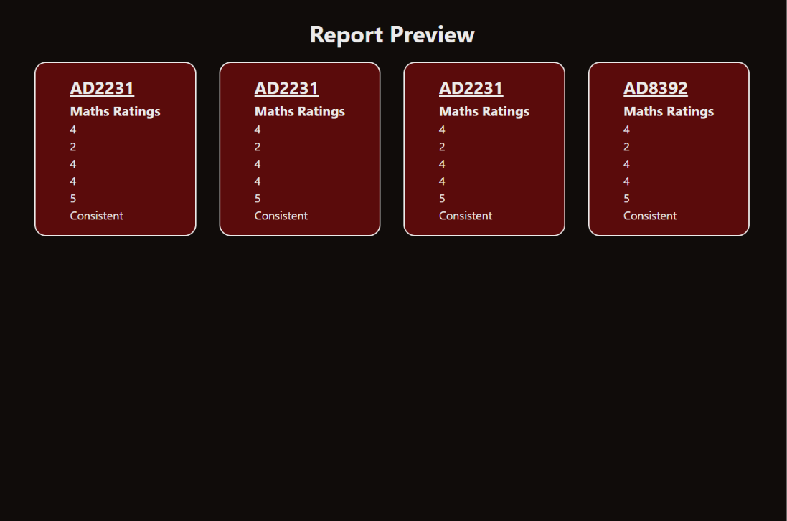
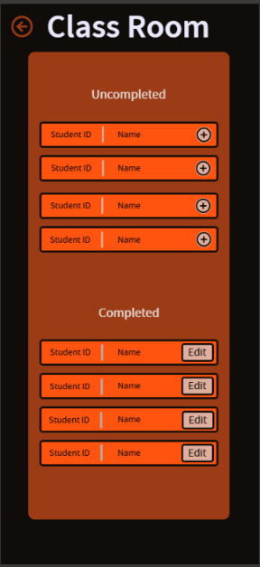
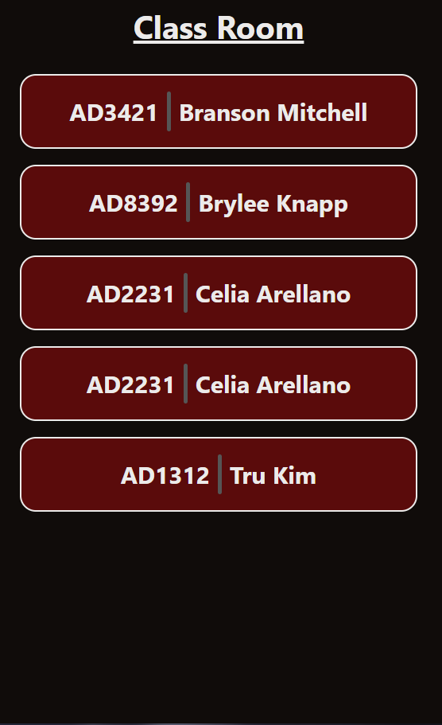
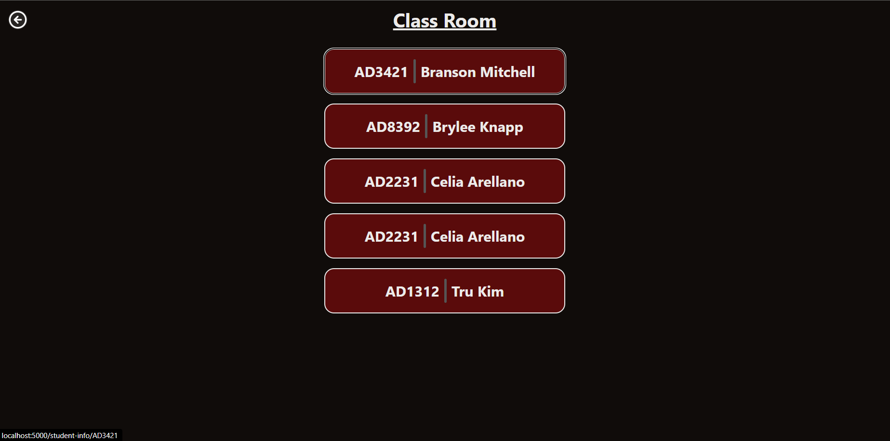
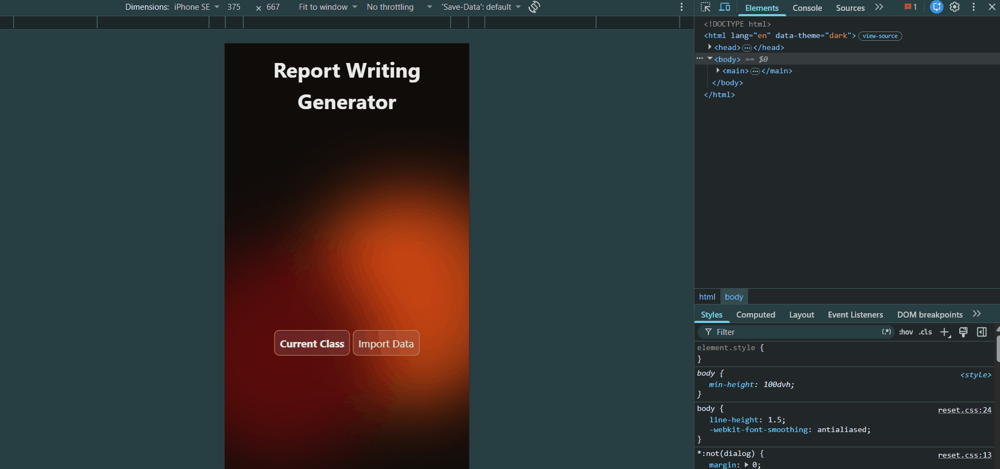
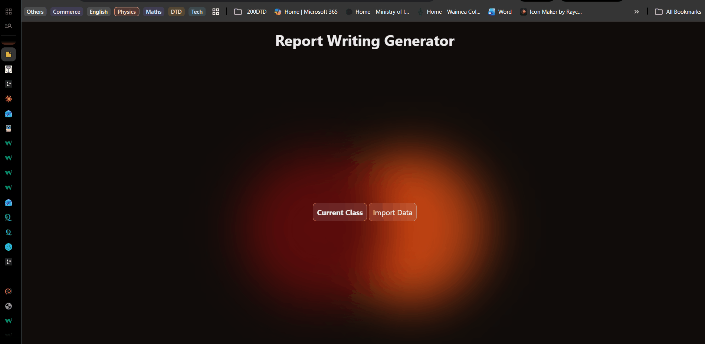
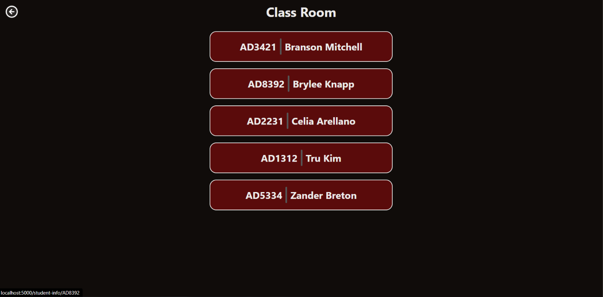
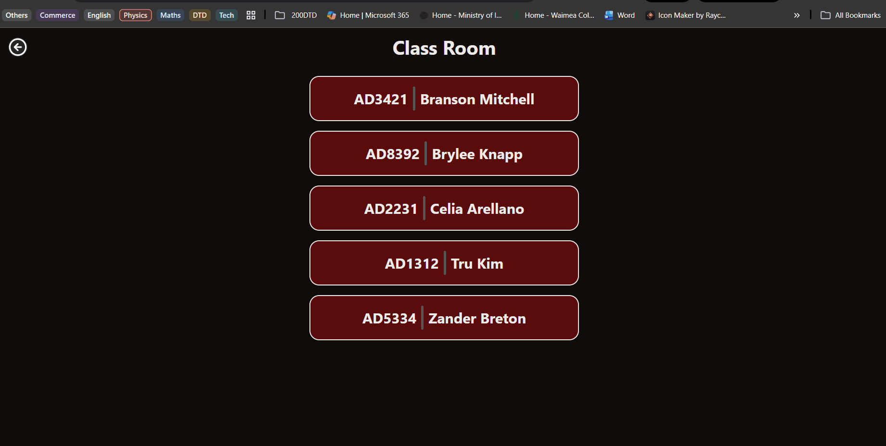

# Sprint 2 - Implement Database and Display of Test Data

## Sprint Goals

Implement the database, populated with test data. Create queries that retrieve test data, and display this on web pages as needed. Test and refine the queries and data display, so that it stands as the basis of the next sprint.

### Specific Goals

**Edit these goals as needed**

- Implement the database
- Add test data to the database
- Create the following web pages:
    - Home pages showing the two options shown in my test UI flow. 
    - Successfully display a page where the user can import student names. 
    - Etc.
- Develop SQL database queries to:
    - Retrieve all data nessacery for the report to be generated.
    - Retrieve specific information such as student names.
    - Etc.

## Test 1 - Displaying Seed Data of Student Info

I am testing whether the seed data I added into the data bases were accessable and displaying on the front end. I did this by creating a page that shows some information from these data bases, such as student id, ratings for subjects and overall rating. I was able to display some test data hich proved that the connection is working.

**PLACE SCREENSHOTS AND/OR ANIMATED GIFS OF THE TESTING HERE**

### Changes / Improvements

After a discussion with my stakeholder, he asked the question "How will I be able to pick a student from the class list to view there report?" - Gareth 
This made me realise that there is a massive flaw in the system. The user cannot look back on reports or students as the ID isn't being stored anywhere accessable to call. This should be changed so that the student's id is stored in the URL so the database knows which information to show for the correct stduent.

"Could you have a page where all of my students are showed, so I can select which student I want to create a report for?" - Gareth
Further discussion with my stakeholder revealed that it would be a much better idea to have a class list page with a list of students that show their name and student ID

**PLACE SCREENSHOTS AND/OR ANIMATED GIFS OF THE IMPROVED SYSTEM HERE**

Here is the UI mock up:

## Test 2 - Class Room Page

I will be testing whether the class room page displays the student name and student ID as it should in the desired order.

**PLACE SCREENSHOTS AND/OR ANIMATED GIFS OF THE TESTING HERE**

### Changes / Improvements

"Can the students be ordered in Alphabetical order?" - Gareth 
I will sort the students names A to Z and display them in this order.

"What term does the plus button bring you to?" - Gareth 
The plus button was the original link to the term selection page, for clearity I will remove the plus button and replace it by making the student's container a link itself.

**PLACE SCREENSHOTS AND/OR ANIMATED GIFS OF THE IMPROVED SYSTEM HERE**

## Testing Student Info 

I will be testing whether a report of the student can be displayed using seed data when selecting someone from the list for any term.

**PLACE SCREENSHOTS AND/OR ANIMATED GIFS OF THE TESTING HERE**

### Changes / Improvements
No changes were made to the strauture of the database.

**PLACE SCREENSHOTS AND/OR ANIMATED GIFS OF THE IMPROVED SYSTEM HERE**

## Testing Class Room List

I will test whether multiple students can be shown on the classroom list using seed data.

### Changes / Improvements
No changes were made to the strauture of the database.

## Testing Student Info

I will test whether student info will show the corrosponding term data. 

### Changes / Improvements
No changes were made to the strauture of the database.

## Sprint Review

In reflection, there was a major oversite for my data base at the beginning of this sprint, through the feedback of my stakeholder I was able to restructure and create a functional database that met the requirments set by my stakeholder. Through this improvement of my data base it has allowed me to more efficiently display data.

