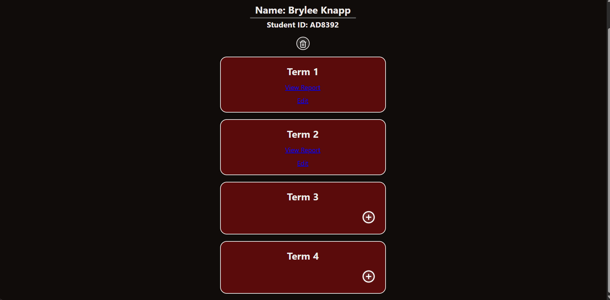
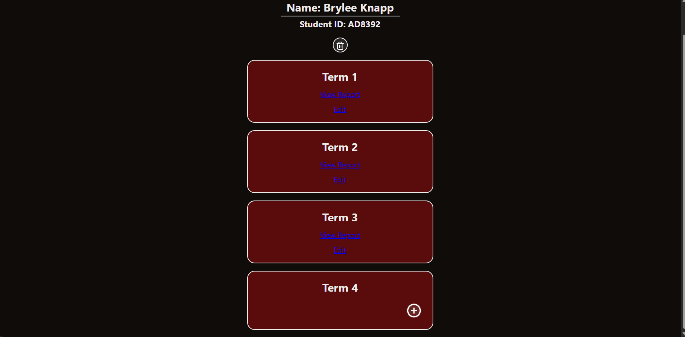
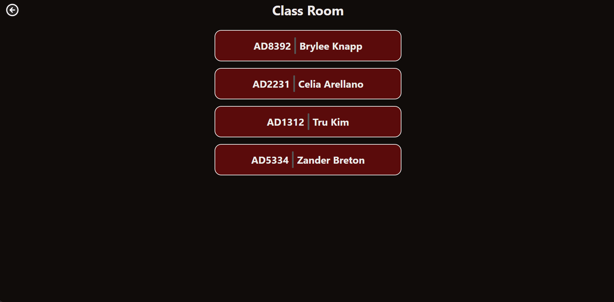
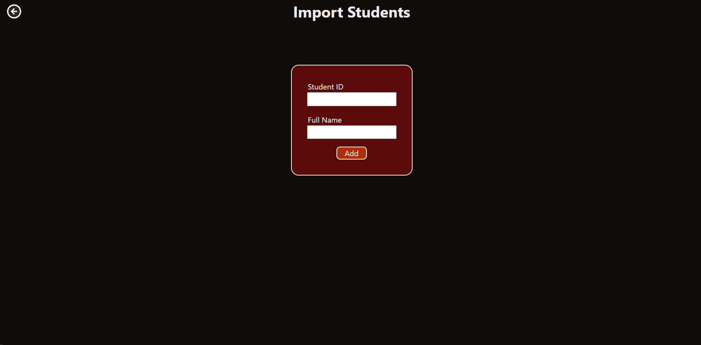

# Sprint 3 - Developing a Minimum Viable Product (MVP)

## Sprint Goals

Continue to develop the web application to the point that it provides all key functionality of the system. Test and refine it so that it can serve as the basis for the final phase of development.

### Specific Goals

**Edit these goals as needed**

- Create the following web pages:
    - Form to create a report for a student for a specific term.
    - Form to edit the report of a student for a specific term.
    - Final report generator page.
    - A page to add a student.

- Develop SQL database queries to:
    - Add new students
    - Fetch all information needed to display the final report.
    - Add data to a term for the report.
    - Delete all data related to a student (all records)

## Testing The Form for a Student's Term Report.

I will test this by going through and filling out the form for a seeded student, for all there terms. I will show one of them being filled bellow. 

**PLACE SCREENSHOTS AND/OR ANIMATED GIFS OF THE TESTING HERE**

### Changes / Improvements

Gareth - "To make it easier to see the postion of the sliders, can there be numbers underneath each slider to represent each notch? Also can there be a key to show what each number represents as a performance indicator?" 

**PLACE SCREENSHOTS AND/OR ANIMATED GIFS OF THE IMPROVED SYSTEM HERE**

I added numbers underneath each slider as well as a key to allow for better comprehension of what they represent in the report.

## Testing Editing a Student's Term Report

I will test whether a student's report can be edited by filling out the edit form the displays the current values so they can be changed.

**PLACE SCREENSHOTS AND/OR ANIMATED GIFS OF THE TESTING HERE**

### Changes / Improvements

No changes were made, my stakeholder was satisfied with the current state of my editing system.

## Testing Student Final Report

I will test whether the final report of the student can be displayed correctly. I will do this by selecting a term report of a seeded student. 

**PLACE SCREENSHOTS AND/OR ANIMATED GIFS OF THE TESTING HERE**

### Changes / Improvements

Gareth - "I think that it would be a good idea to remove the ability to adjust the sliders in the report view as they don't edit the report. Also there should be a key for parents, it should show the achievement descriptors and what they mean."

**PLACE SCREENSHOTS AND/OR ANIMATED GIFS OF THE IMPROVED SYSTEM HERE**

## Testing Student Add Page

I will test the page where you are able to add a student to the class list.

**PLACE SCREENSHOTS AND/OR ANIMATED GIFS OF THE TESTING HERE**

## Sprint Review

Replace this text with a statement about how the sprint has moved the project forward - key success point, any things that didn't go so well, etc.

