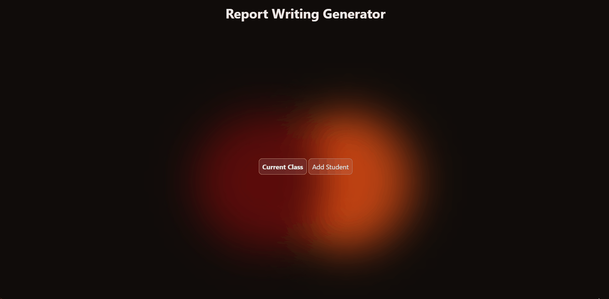
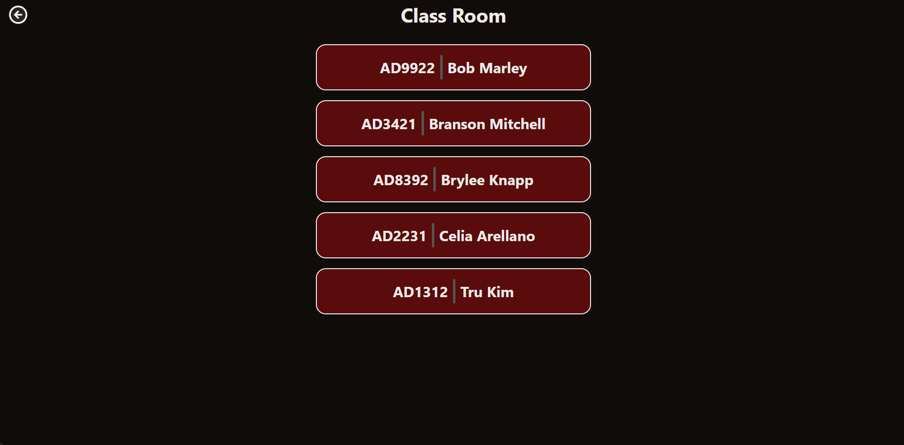
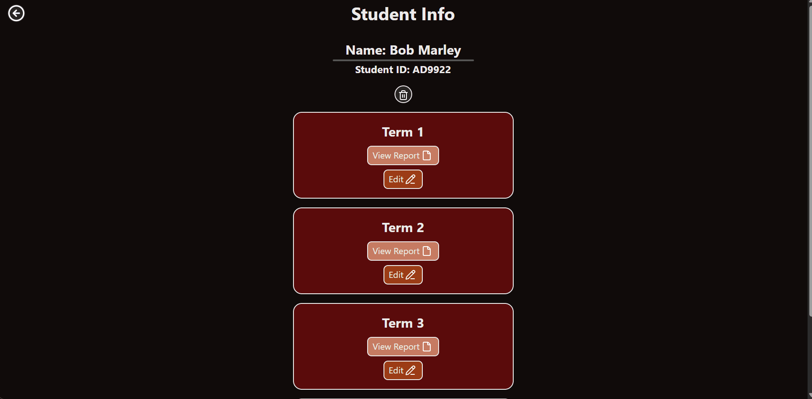
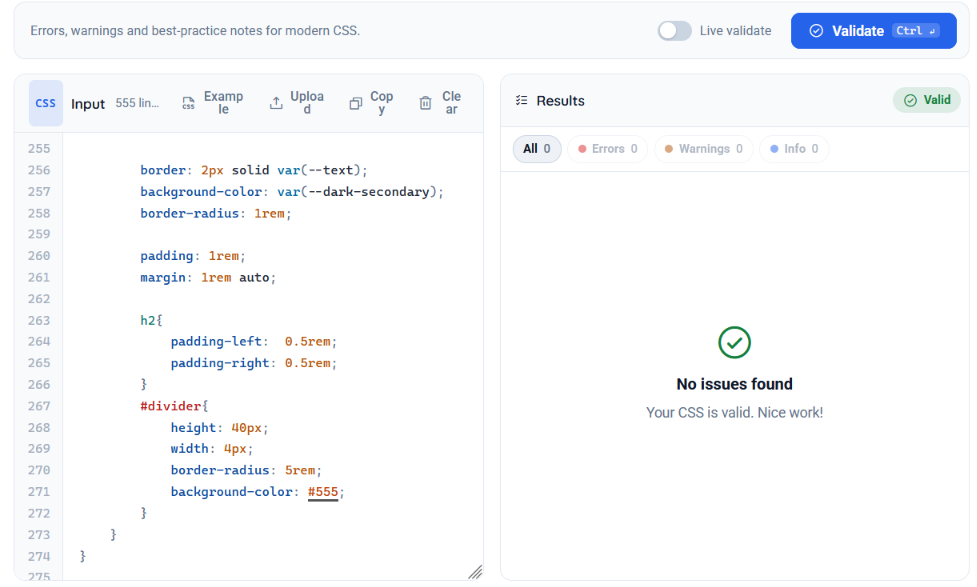
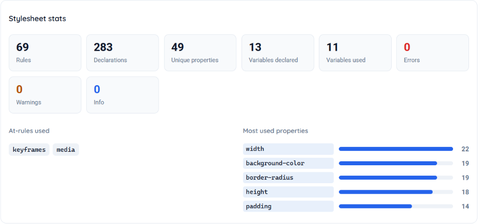
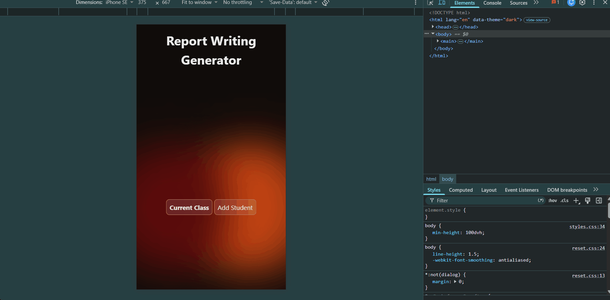

# Sprint 4 - Developing a Refined and Complete System

## Sprint Goals

Develop the system until it is fully featured, with a refined UI and it satisfies the requirements. The system will be fully tested at this point.

### Specific Goals

**Edit these goals as needed**

- Refine the design and UI of the website
- Refine the user experience (UX) of the system
- Perform final, full-system testing
- Does my CSS validate

## Testing back buttons on every page

I am testing whether all of the back buttons are correctly routed to the right pages. 

**PLACE SCREENSHOTS AND/OR ANIMATED GIFS OF THE TESTING HERE**

Yes the back button also works on the add student page.

### Changes / Improvements

Gareth - "Can you add a change in colour to show that the button is being hovered on? Could you use the accent colour for this?"

## Testing the hover state on every button

I am testing whether the hover state of every button successfully changes the colour of the button's background colour.

**PLACE SCREENSHOTS AND/OR ANIMATED GIFS OF THE TESTING HERE**

### Changes / Improvements

Gareth - "Can you add icons to the view report and edit buttons on the student info page? Something such as a pencil for edit and piece of paper for view would be good."

**PLACE SCREENSHOTS AND/OR ANIMATED GIFS OF THE IMPROVED SYSTEM HERE**

## Testing Whether my CSS Validates

I will place my CSS file into the https://www.cssportal.com/css-validator/ to see whether it validates with no errors

**PLACE SCREENSHOTS AND/OR ANIMATED GIFS OF THE TESTING HERE**

### Changes / Improvements

No changes were made as the CSS validated with no errors!

## Testing On a Mobile Device 

I will test what every page of my application looks like on a mobile device. I will use chrome webtools to demonstatrate what it would look like for my stakeholder to view.

### Changes / Improvements

No changes were made as my stakeholder was satisfied with the mobile view.

## Sprint Review

This sprint allowed me to further refine my UI design of the system, through the feedback of my stakeholder it helped me design the UI in a way which met their requirements.

Gareth - "Throughout this sprint Zander has asked solid questions, which allowed me to communicate my requirements. This helped Zander integrate my feedback into the design."

