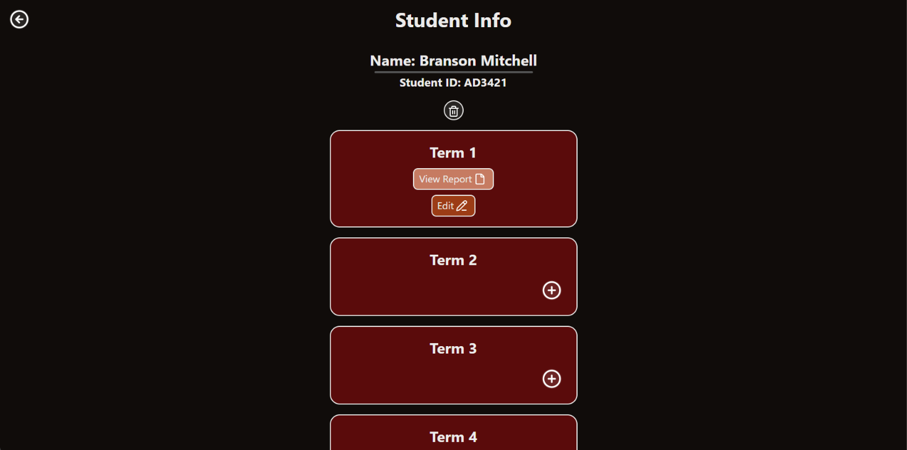
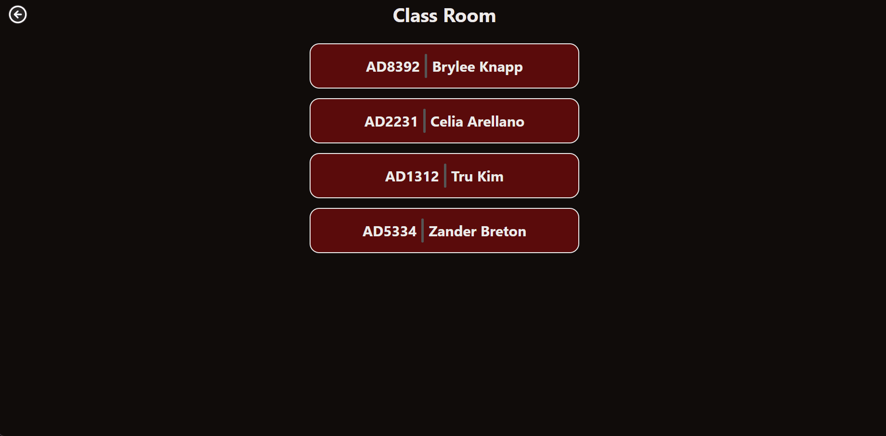
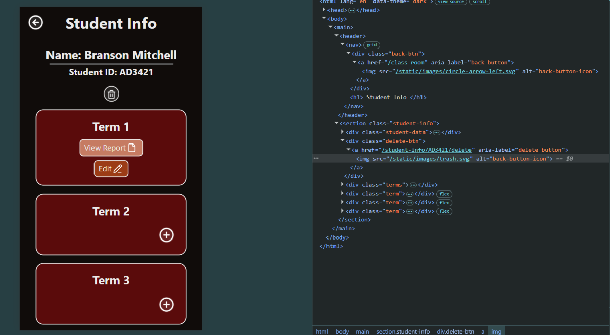
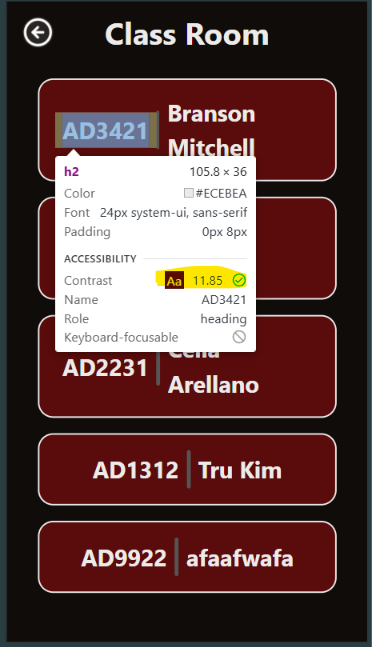

# Project Final Review and Reflection

## Addressing Relevant Implications

### End-User 

I believe that I have created a system that was catered to my end users requirements. Some of the requirements that were set by my stakeholder Gareth were:

- Simple UI.
- Streamlined for speed.
- Effcient use of elements.
- Apply HSS Report writing style guide and adhere to the rules detailed within this document.
- Use example comments to generate new comments using the appropriate tone.
- Use correct NZ grammar.

The five numbers will need to match the following achievement descriptors: emerging, developing, consolidating, proficient and exceeding.

The use of uncluttered simple UI can be found throughout the website, for example on the student info page.

We can see that the use of padding and margin to separate UI as well as correct placement of UI pieces help create a front end that is readable as well as user friendly.

The use of icons helps the user quickly identify the action that they are looking for so that they can efficiently use the system.

As requested by my stakeholder, I have ensured that the final report applies the HSS report writing guide and rules. This can be seen on the following page:

### Usability

I have ensured that during the design process of my system to clearly communicate with my stakeholder, this allowed me to produce a product that was catered specifically to his needs. I used a colour palette that was selected by the stakeholder, and applied it throughout the website. To maintain consistency I used the :root css function which allowed me to create my primary, secondary, and accent colours into 

### Functionality

My end product does not crash randomly, throw unknown server errors or break entirely. This allows for my end user to successfully use my system with comfort in its reliability. 

### Privacy

All data that is created by the user can be completly earased from the database, this gives the user full control over their information that they are sharing. My application does not collect any form of personal data during the use of the site, this allows for the users iteraction with the system to stay anonymous protecting their digital and physical identities.

### Accessibility

To ensure that the system I created was accessable for all types of users, I included aria labels on icons without text, this allows those that may be impared to be read what the icon is, allowing them to know it's purpose.

I also ensured that the contrast for all of my UI met the minimum recommended standards so that every user is able to easily read text and recognize icons to allow them to navigate successfully through the website. I used chrome dev tools to check my contrast levels as seen in the screen shot below:

## Overall Review

Overall I believe that the system turned out well, I was able to take on stakeholder feedback and integrate it into the functionality of the website. I produced a report writing generator where you could add a student, create a report for each of the four terms as well as display all of the collected information from my form in a styled report view.

## Final Stakeholder Feedback 

Gareth - "Zander was able to produce an efficient system that follows the report writing guidlines and requirements. It was not only functional but useful for creating student reports. Features such as the class list, editing and student info saving improved the overall usability of the website. I was satisfied with the colour scheme and UI placement. It was clear that my feedback was taken on board during the design process."

## What went well?

I think that the front end design of the website went reall well, my CSS was well structured and maintainable which made it easy to fix bugs and fine tune the UI of my website. This helped me produce a final product that I am proud to present to my end user.

## What didn't go so well?

I think that a lot of the back end logic was very time consuming, it would have been a good idea to learn some more python and SQL before creating the backend. Although, I was still able to produce a robust backend with some error prevention.

## How did the testing/trialling impact the final system?

Through the use of testing and trialling I was able to weed out any mistakes or bugs that were hidden in the system. This helped me stream line the user experience and prevent frustration that could be caused by unexpected errors.

## What would you do differently if you could?

I should have asked for help regarding SQL queries and other back-end related topics earlier to allow myself ample time to hand in the project on time. This would have prevented me from needing to stay up late and work on the project for long stretches of time.

